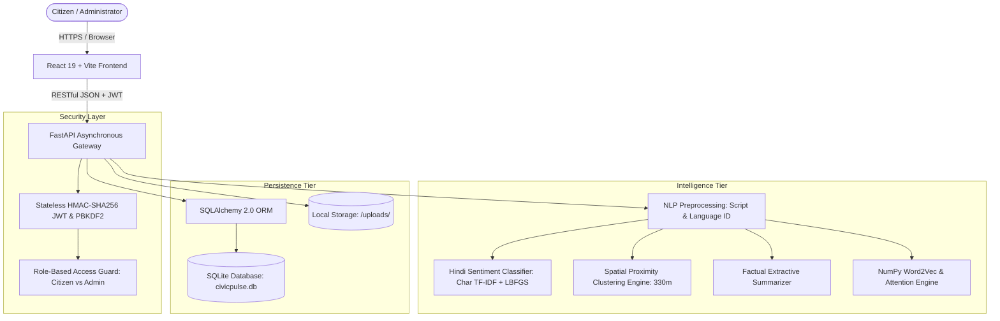
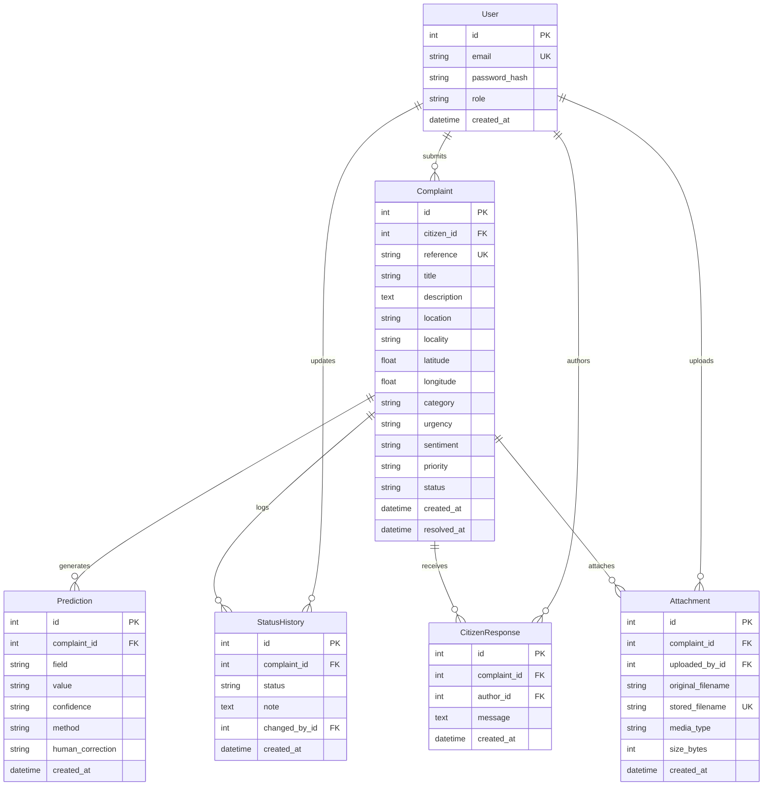

# CivicPulse: Multilingual Civic Complaint Intelligence Platform — Complete Project Overview & Technical Report

**Project Title:** CivicPulse — Multilingual Civic Complaint Intelligence & NLP Research Platform  
**Target Domain:** Local-First Municipal Governance & Natural Language Processing  
**System Profile:** CPU-Executable, Offline-Capable, Zero-Cloud-Dependency Architecture  
**Academic Document Date:** November 2026  
**Status:** Fully Audited, Bug-Fixed, Verified & Production-Demo Ready

---

# PART A — PROJECT INTRODUCTION

## 1. Project Title
**CivicPulse: Multilingual Civic Complaint Intelligence and Grievance Redressal Platform**

## 2. Abstract
Urban local bodies in multilingual societies face severe operational bottlenecks in triaging citizen grievances due to linguistic fragmentation (English, Devanagari Hindi, and code-mixed Romanized Hinglish), lack of automated spatial crisis detection, and the unreliability of generative large language models that risk hallucinating critical factual details. This project presents **CivicPulse**, a lightweight, local-first intelligence platform engineered to ingest, categorize, prioritize, summarize, and map citizen grievances on standard commodity CPU hardware without cloud dependencies or paid APIs. CivicPulse combines a Unicode-aware multi-script tokenizer, in-memory subword character n-gram sentiment classification for Hindi, proximity-based incident escalation using coordinate clustering (~330m cells), and a verbatim extractive summarization engine with sentence-level citation tracking. We evaluate our platform across 5,228 Hindi sentiment records, achieving **72.85% accuracy** (Macro F1: 0.6963) on untouched held-out test data, and establish a reproducible baseline of **33.33% accuracy** on a 120-record bilingual civic complaint benchmark, diagnosing the mathematical causes of cross-lingual vocabulary sparsity. The application is delivered via an asynchronous FastAPI backend and a responsive React single-page frontend with Leaflet mapping, verified by a 17-point automated test suite.

## 3. Introduction
In urban municipal administration, rapid and accurate response to civic failures—such as contaminated water pipelines, electrical transformer faults, open manholes, and uncollected garbage—is fundamental to public health and safety. Modern governance portals frequently fail because they assume monolingual English literacy and structured data entry. In reality, citizens express grievances in colloquial, multi-script forms. A resident in Delhi or Lucknow may write in Devanagari Hindi, formal English, or colloquial Hinglish (*"Hamare ward mein pichle 5 din se pani nahi aa raha hai"*). CivicPulse Bridges this communication divide by providing an intelligent, evidence-grounded municipal operating system.

## 4. Background
Traditional civic grievance redressal platforms (such as CPGRAMS or municipal portals) operate primarily as passive ticketing systems. Complaints are placed into linear queues and manually inspected by clerks. This creates significant delays, fails to identify duplicate reports, and treats 50 individual calls about a burst water main as 50 isolated incidents rather than a single acute infrastructure crisis. While recent research has explored applying deep neural networks and Large Language Models (LLMs) to civic tech, these approaches introduce prohibitive hardware costs, recurring cloud API expenses, citizen privacy vulnerabilities, and the risk of generative hallucination.

## 5. Problem Statement
To design, implement, evaluate, and verify an end-to-end, local-first software platform capable of:
1. Ingesting and accurately preprocessing multi-script citizen grievances in English, Hindi, and Hinglish.
2. Providing transparent category suggestions and sentiment classifications on modest CPU hardware.
3. Preventing generative hallucinations by enforcing sentence-level citation provenance in summaries.
4. Automatically aggregating localized reports within a 330-meter proximity cell and dynamically escalating incident priority.
5. Providing verifiable administrative tracking, interactive geographic mapping, and educational NLP algorithm inspection.

## 6. Motivation
1. **Inclusivity:** Empower non-English literate citizens to file grievances in their native tongue and script without friction.
2. **Operational Efficiency:** Enable municipal administrators to immediately distinguish isolated nuisances from widespread community crises.
3. **Data Sovereignty & Privacy:** Ensure citizen home coordinates, phone numbers, and grievances remain strictly on local municipal servers without leaking to third-party proprietary AI cloud providers.
4. **Academic Transparency:** Bridge the university NLP curriculum (Units I–VI) with a production-quality open-source implementation where every algorithm is mathematically explainable.

## 7. Objectives
1. Build a robust, asynchronous REST API using FastAPI, Pydantic v2, and SQLite with SQLAlchemy 2.0 ORM.
2. Implement a responsive React 19 frontend with Leaflet mapping, GPS integration, and photo uploads.
3. Engineer a script-aware NLP pipeline for tokenization, normalization, and stop-word filtering across English, Hindi, and Hinglish.
4. Implement and evaluate an in-memory subword character n-gram Hindi sentiment classifier achieving $\ge 70\%$ test accuracy.
5. Implement a pure NumPy Word2Vec (CBOW and Skip-gram) embedding engine with negative sampling and PCA projection.
6. Implement a zero-hallucination extractive summarizer with complete sentence-level evidence linkage.
7. Implement proximity-based incident clustering and dynamic priority escalation (`Normal` $\rightarrow$ `High` $\rightarrow$ `Critical`).
8. Establish reproducible experimental baselines and conduct deep forensic error analyses on civic benchmarks.

## 8. Scope
- **In Scope:** Local-first execution on commodity CPUs; English, Devanagari Hindi, and Romanized Hinglish processing; 6 civic categories (`Water Supply`, `Electricity`, `Healthcare`, `Sanitation`, `Roads/Transport`, `Ration/Aadhaar`); interactive mapping; automated unit/integration testing; educational research demonstrations.
- **Out of Scope (By Design):** Proprietary cloud LLM integrations (OpenAI/Gemini/Anthropic); GPU-heavy transformer pretraining; automatic ticket merging without human confirmation; production container cluster orchestration.

## 9. Proposed Solution
CivicPulse introduces a hybrid intelligence model:
- **Transparent Linguistic Rules:** For script detection, Hinglish identification, and category keyword extraction.
- **Trained Machine Learning Models:** Subword character n-gram TF-IDF with multinomial Logistic Regression for Hindi sentiment.
- **Pure Algorithmic Engines:** Pure NumPy implementations for negative-sampling Word2Vec embeddings and scaled dot-product attention demonstrations.
- **Factual Extractive Summarization:** Verbatim sentence ranking with citation indices.
- **Deterministic Geospatial Intelligence:** Euclidean coordinate grid filtering for incident clustering.

## 10. Key Contributions
1. **Zero-Hallucination Civic Summarization:** Every generated summary sentence links directly to its source sentence index, ensuring 100% legal and operational accountability.
2. **Proximity-Based Incident Escalation:** A spatio-temporal clustering engine that detects localized civic crises within ~330m cells and dynamically escalates priority (`Normal` $\rightarrow$ `High` $\rightarrow$ `Critical`).
3. **Reproducible Multilingual Sentiment:** A verified 72.85% test accuracy on 523 held-out Hindi records with complete confusion matrices and dependency compatibility documentation.
4. **Forensic Cross-Lingual Analysis:** Empirical diagnosis explaining the mathematical causes of cross-lingual vocabulary sparsity on 120 bilingual complaints.
5. **Production-Quality Open Source Stack:** Fully verified with 17 automated tests, complete documentation, and zero external API dependencies.

---

# PART B — TECHNICAL ARCHITECTURE

## 1. Overall Architecture

## 2. Frontend Architecture
The client is a single-page application built with React 19 and Vite:
- **Component Hierarchy:**
  - `App`: Top-level router and navigation controller based on active JWT state.
  - `Auth`: Citizen signup, login, and administrative key authentication.
  - `Dashboard`: Four-card summary metrics and category/sentiment distribution graphs.
  - `Submit`: Geospatial grievance submission form with Leaflet interactive pin picker, reverse geocoding, GPS locator, and multi-photo upload.
  - `Intelligence`: Real-time grievance analysis report showing predicted category, sentiment, duration, and lexical similarities.
  - `Portal` & `AdminUpdate`: Review queues (Citizen personal history vs Admin priority triage).
  - `Geographic`: Interactive nationwide map with category-coded markers and density heatmap.
  - `Research`: Interactive laboratory for token inspection, Skip-gram training, and attention matrix visualization.
  - `Datasets`: Read-only dataset manifest inventory.

## 3. Backend Architecture
The backend is an asynchronous Python service built on FastAPI and Uvicorn:
- **Modularity:**
  - `backend/app/core/`: Configuration settings and HMAC-SHA256 JWT security utilities.
  - `backend/app/database/`: SQLite engine, session maker, and schema migration logic.
  - `backend/app/models/`: SQLAlchemy 2.0 declarative database entities.
  - `backend/app/schemas/`: Pydantic v2 data contracts enforcing strict validation.
  - `backend/app/nlp/`: Script identification, language estimation, tokenization, civic keyword classification, and Hindi sentiment modeling.
  - `backend/app/services/`: Research demonstrations (Word2Vec, Attention), extractive summarization, and translation adapters.
  - `backend/app/main.py`: ASGI routing, lifespan management, CORS middleware, and endpoint handlers.

## 4. Database Architecture (Entity-Relationship Diagram)

## 5. Authentication & Authorization Design
- **Password Protection:** PBKDF2 with SHA-256 and automatic per-user salt generation.
- **Session Tokens:** Stateless JWT tokens containing `sub` (User ID), `role` (`citizen` or `admin`), and `exp` (timestamp).
- **Constant-Time Verification:** Signatures are validated via `hmac.compare_digest()` to eliminate timing attack vectors.
- **Role Guards:** Administrative endpoints require `require_admin`, returning HTTP 403 Forbidden to regular citizens.
- **Resource Ownership:** Citizens requesting complaints or attachments are restricted to their own `citizen_id` via `complaint_for_user()`.

## 6. Technology Stack with Exact Tested Versions

| Component | Library / Framework | Exact Version | Purpose |
|---|---|---|---|
| **Runtime Environment** | Python | 3.12.4 | Underlying backend execution runtime |
| **Web Framework** | FastAPI | 0.135.3 / 0.115.6 | Asynchronous RESTful API framework |
| **ASGI Web Server** | Uvicorn | 0.44.0 | Asynchronous HTTP server |
| **Data Validation** | Pydantic | 2.13.0 / 2.10.3 | Request/response schema contracts |
| **Database ORM** | SQLAlchemy | 2.0.49 / 2.0.36 | Database abstraction and relational modeling |
| **Password Hashing** | Passlib | 1.7.4 | Salted PBKDF2-SHA256 password security |
| **Machine Learning** | Scikit-learn | 1.8.0 / 1.6.0 | Logistic Regression, TF-IDF, PCA |
| **Array Computing** | NumPy | 2.4.4 | Vector math for pure Word2Vec and Attention |
| **Testing Framework** | Pytest | 9.0.3 | Automated unit and integration test runner |
| **HTTP Client** | HTTPX | 0.28.1 | Asynchronous HTTP client for test suites |
| **Frontend Runtime** | Node.js / NPM | v24.14.1 / 11.11.0 | Frontend build environment |
| **Frontend Framework** | React | 19.x (latest) | User interface library |
| **Build Tool** | Vite | 8.3.5 | Frontend module bundler and dev server |
| **Map Rendering** | Leaflet.js | 1.9.4 | Open-source interactive mapping library |

---

# PART C — DATASET DOCUMENTATION

CivicPulse includes five canonical datasets verified during the Phase 3 audit:

### 1. Civic Complaints Benchmark (`civic_complaints_labeled.csv`)
- **Total Records:** 120 rows.
- **Source Package:** `Akshay_2.zip` (Source original under `raw/source_originals/metadata.csv`).
- **Publisher / License:** Provenance unconfirmed; publisher and licensing terms were not specified in source package.
- **Schema Fields (9):** `complaint_id`, `text`, `source_transcript`, `category`, `language`, `script`, `source_filename_reference`, `data_source`, `is_synthetic`.
- **Language Breakdown:** Exactly 60 English (Latin script) and 60 Hindi (Devanagari script).
- **Class Distribution:** Perfectly balanced across 6 categories: `electricity` (20), `healthcare` (20), `ration_aadhar` (20), `roads_transport` (20), `sanitation` (20), `water_supply` (20).
- **Splits:** No official split supplied; derived stratified 75:25 split (90 train / 30 test, `random_state=42`) used in baseline experiments.
- **Data Quality:** Zero missing values in primary fields; `is_synthetic` is 100% blank (unverified provenance); 0 duplicate texts. Audio files referenced in metadata are absent.
- **Project Usage:** Category classification baseline and corpus for NumPy Word2Vec training.

### 2. Hindi Sentiment Dataset (`hindi_sentiment_{train,validation,test}.csv`)
- **Total Records:** 5,228 rows across 3 fixed splits.
- **Source Package:** `hi-train.csv`, `hi-valid.csv`, `hi-test.csv`.
- **Publisher / License:** General-domain Hindi review/news dataset; license unconfirmed.
- **Schema Fields (4):** `sentiment`, `text`, `split`, `data_source`.
- **Splits & Classes:**
  - `Train` (4,182 rows): Positive (1,826), Neutral (1,789), Negative (567).
  - `Validation` (523 rows): Positive (223), Neutral (223), Negative (77).
  - `Test` (523 rows): Positive (241), Neutral (214), Negative (68).
- **Data Quality:** UTF-8 BOM encoding handled via `utf-8-sig`. Zero nulls. Zero text overlap between train and test splits (0% leakage). 4 duplicate rows within train split retained to preserve canonical split parity.
- **Project Usage:** Trained in-memory subword character n-gram sentiment model.

### 3. Hinglish Sentiment Dataset (`hinglish_sentiment.csv`)
- **Total Records:** 2,766 rows.
- **Source Package:** `Hinglish.csv`.
- **Publisher / License:** Unverified provenance.
- **Schema Fields (5):** `source_row_id`, `text`, `sentiment`, `label`, `data_source`.
- **Class Breakdown:** Neutral (1,234 rows / 44.6%), Positive (987 rows / 35.7%), Negative (545 rows / 19.7%).
- **Splits:** Single file; no official train/validation/test split supplied.
- **Data Quality:** Contains 45 repeated text values (2,720 unique texts).
- **Project Usage:** Read-only dataset explorer inventory; intentionally not used for unsupported production accuracy claims.

### 4. Hindi Named Entity Recognition (`hiner_{train,validation,test}.json`)
- **Total Records:** 108,335 sentences.
- **Source Package:** `train.json`, `validation.json`, `test.json` (and matching `.conll` files).
- **Publisher / License:** Standard Hindi BIO Named Entity Recognition benchmark; license unverified.
- **Splits:** Train: 75,827 rows (70%); Validation: 10,851 rows (10%); Test: 21,657 rows (20%).
- **Tagset:** 23 BIO labels (B- and I- prefixes for FESTIVAL, GAME, LANGUAGE, LITERATURE, LOCATION, MISC, NUMEX, ORGANIZATION, PERSON, RELIGION, TIMEX + Outside `O`).
- **Data Quality:** 100% token-tag length consistency across all 108,335 records. Alternate CoNLL format provided.
- **Project Usage:** Read-only inventory and designated future fine-tuning dataset.

### 5. English–Hindi Parallel Translation Text (`parallel_{dev,test}.{en,hi}`)
- **Total Records:** 3,027 sentence-aligned pairs.
- **Source Package:** `dev.en`/`dev.hi` and `test.en`/`test.hi`.
- **Publisher / License:** Sentence-aligned bilingual corpus; license unverified.
- **Splits:** Development split: 520 pairs; Test split: 2,507 pairs; **Training split: 0 pairs (Absent).**
- **Data Quality:** Exact sentence alignment; 0 empty lines.
- **Project Usage:** Alignment inspection only. The absence of a training split prevents training a custom Seq2Seq model; development pairs are strictly protected from being misused as training data.

---

# PART D — COMPLETE NLP METHODOLOGY

Every implemented natural language processing method in CivicPulse is detailed below with its mathematical formulation, source code references, and operational boundaries:

### 1. Script Detection
- **Definition:** Classifying text into script categories based on character Unicode code points.
- **Why It Is Used:** Distinguishes Devanagari Hindi from Latin English/Hinglish to route text to language-specific tokenizers and stop-word filters.
- **Mathematical Rule:**
  $$\text{script}(T) = \begin{cases} 
  \text{"Devanagari"}, & \text{if } \sum_{c \in T} \mathbb{I}(c \in [\text{U+}0900, \text{U+}097\text{F}]) > 0 \land \sum_{c \in T} \mathbb{I}(c \in \text{ASCII\_alpha}) = 0 \\
  \text{"Latin"}, & \text{if } \sum_{c \in T} \mathbb{I}(c \in \text{ASCII\_alpha}) > 0 \land \sum_{c \in T} \mathbb{I}(c \in [\text{U+}0900, \text{U+}097\text{F}]) = 0 \\
  \text{"Mixed"}, & \text{if both sums} > 0 \\
  \text{"Unknown"}, & \text{otherwise}
  \end{cases}$$
- **Source File & Function:** `backend/app/nlp/preprocessing.py:script_of(text)`
- **Example:** Input `"पानी नहीं आ रहा"` $\rightarrow$ Output `"Devanagari"`.

### 2. Language & Code-Mixing Estimation
- **Definition:** Heuristic identification of code-mixed Romanized Hindi (Hinglish) vs standard English.
- **Why It Is Used:** Prevents treating Hinglish as English, ensuring stop-words like *"nahi"* or *"hai"* are not stripped.
- **Formulation:** Evaluates word tokens $W = \text{tokenize}(T)$. If $|\{w \in W\} \cap \text{ROMAN\_HINDI}| \ge 2$, returns `Hinglish (estimated)`; otherwise `English (estimated)`.
- **Source File & Function:** `backend/app/nlp/preprocessing.py:language_of(text)`
- **Example:** Input `"Hamare area mein pani nahi hai"` $\rightarrow$ Matches `{"hamare", "mein", "pani", "nahi", "hai"}` ($5 \ge 2$) $\rightarrow$ `Hinglish (estimated)`.

### 3. Unicode-Aware Tokenization
- **Definition:** Splitting text into meaningful lexical tokens while respecting multi-byte Indian scripts.
- **Formulation:** Unicode regular expression matching word characters and the Devanagari code block:
  $$r"[\w\u0900-\u097f]+"$$
- **Source File & Function:** `backend/app/nlp/preprocessing.py:tokenize(text)`
- **Example:** `"अस्पताल में 2 दिन से"` $\rightarrow$ `["अस्पताल", "में", "2", "दिन", "से"]`.

### 4. Language-Selective Stop-Word Filtering
- **Definition:** Pruning high-frequency grammatical tokens with low category discriminative power.
- **Formulation:**
  $$T_{filtered} = \{t \in T_{tokens} \mid t \notin S_{\text{lang}}\}$$
  where $S_{\text{Hindi}} = \{\text{और}, \text{का}, \text{की}, \text{के}, \text{में}, \text{है}, \dots\}$ and $S_{\text{English}} = \{\text{the}, \text{is}, \text{at}, \text{which}, \dots\}$. If language is Hinglish, $S = \emptyset$.
- **Source File & Function:** `backend/app/nlp/preprocessing.py:analyse(text)`

### 5. In-Memory Subword Character N-Gram TF-IDF
- **Definition:** Extracting subword character n-grams bounded by word boundaries.
- **Why It Is Used:** Captures Hindi morphological inflections, prefixes, and suffixes without external lemmatizers.
- **Formulation:** For word $w$, extracts character sequences of length $3 \le n \le 5$ with word boundary padding: `char_wb`.
- **Source File & Function:** `backend/app/nlp/sentiment.py:hindi_sentiment_model()`

### 6. Multinomial Logistic Regression with LBFGS
- **Definition:** Linear classification model that estimates class posterior probabilities using the softmax function.
- **Mathematical Formulation:**
  $$P(Y = k \mid x) = \frac{\exp(w_k^T x + b_k)}{\sum_{j=1}^K \exp(w_j^T x + b_j)}$$
  Optimizes multinomial cross-entropy loss with $L_2$ regularization:
  $$\mathcal{L}(W) = -\sum_{i=1}^N \sum_{k=1}^K y_{ik} \log P(Y = k \mid x_i) + \frac{1}{2C} \sum_{k=1}^K \|w_k\|_2^2$$
- **Source File & Function:** `backend/app/nlp/sentiment.py:hindi_sentiment_model()`

### 7. Pure NumPy Word2Vec (CBOW and Skip-gram)
- **Definition:** Continuous dense vector representations learned from civic complaints.
- **Mathematical Formulation:** Sigmoid objective with negative sampling:
  $$\mathcal{L} = -\log \sigma(v^T u) - \log \sigma(-v^T u_{neg})$$
  Analytical gradient updates:
  $$\frac{\partial \mathcal{L}}{\partial u} = (\sigma(v^T u) - 1) v, \quad \frac{\partial \mathcal{L}}{\partial v} = (\sigma(v^T u) - 1) u$$
- **Source File & Function:** `backend/app/services/research.py:word2vec_demo(mode, dimensions, window, epochs)`

### 8. Scaled Dot-Product Attention Demonstration
- **Definition:** Calculation of pairwise token attention weights using scaled dot products.
- **Mathematical Formulation:**
  $$\text{Attention}(Q, K, V) = \text{softmax}\left(\frac{Q K^T}{\sqrt{d_k}}\right) V$$
- **Source File & Function:** `backend/app/services/research.py:attention_demo(text)`

### 9. Factual Extractive Summarization
- **Definition:** Extracting verbatim source sentences ranked by information content and position.
- **Why It Is Used:** Guarantees zero generative hallucinations and 100% evidentiary traceability for municipal administration.
- **Formulation:** Sentences $S = \{s_1, \dots, s_m\}$ ranked by length of non-stopword tokens and position. Emits summary and citation array:
  $$\text{Evidence} = [\{\text{"statement"}: s_i, \text{"source\_sentence"}: s_i, \text{"sentence\_index"}: i\}]$$
- **Source File & Function:** `backend/app/services/summaries.py:factual_summary(text, detail)`

---

# PART E — MODEL DOCUMENTATION

### Model 1: Hindi Sentiment Classifier (`hindi_sentiment_model`)
- **Algorithm:** Multinomial Logistic Regression (`solver="lbfgs"`).
- **Architecture:** `TfidfVectorizer(analyzer="char_wb", ngram_range=(3, 5), min_df=2, sublinear_tf=True)` $\rightarrow$ `LogisticRegression(C=1.0, class_weight="balanced", max_iter=500, random_state=42)`.
- **Input:** Raw Hindi Devanagari text string.
- **Output:** Predicted label (`Negative`, `Neutral`, `Positive`) and confidence score ($[0.0, 1.0]$).
- **Training Procedure:** Trained dynamically in-memory on 4,182 rows of `hindi_sentiment_train.csv` and cached using `@lru_cache(maxsize=1)`. Zero disk model persistence.
- **Evaluation:** Evaluated on 523 untouched test rows: **72.85% accuracy**, **0.6963 Macro F1**, **0.7346 Weighted F1**.
- **Advantages:** Lightweight (trains in ~400ms on CPU), zero model downloads, high minority class recall (72.1% negative recall).
- **Limitations:** Trained on general-domain Hindi reviews/news; not validated specifically on civic complaints.

### Model 2: Pure NumPy Word2Vec (`word2vec_demo`)
- **Algorithm:** Continuous Bag of Words (CBOW) or Skip-gram with negative sampling.
- **Architecture:** Single-layer continuous embedding weights $W_{in} \in \mathbb{R}^{V \times d}$, $W_{out} \in \mathbb{R}^{V \times d}$.
- **Input:** Vocabulary index of center/context tokens.
- **Output:** Dense vectors normalized to unit length, 2D PCA coordinates, and cosine nearest neighbors.
- **Hyperparameters:** Configurable: `dimensions` (2 to 64, default 12), `window` (1 to 5, default 2), `epochs` (1 to 20, default 4), `learning_rate` (0.04).
- **Training Procedure:** Iterative stochastic gradient descent using pure NumPy matrix multiplications.
- **Evaluation:** Tracks empirical training loss per epoch.
- **Advantages:** 100% transparent and educational; runs without PyTorch or Gensim.
- **Limitations:** Trained on small 120-complaint corpus; vocabulary is limited to civic complaint words.

### Model 3: Civic Complaint Category Baseline (`evaluate_civic_baseline`)
- **Algorithm:** Word-level TF-IDF + Logistic Regression baseline.
- **Architecture:** `TfidfVectorizer(ngram_range=(1, 2))` $\rightarrow$ `LogisticRegression(max_iter=400, random_state=42)`.
- **Input:** Bilingual complaint text (English/Hindi).
- **Output:** Category prediction (`electricity`, `healthcare`, `ration_aadhar`, `roads_transport`, `sanitation`, `water_supply`).
- **Dataset:** 120 records from `civic_complaints_labeled.csv` evaluated on stratified 75:25 split (90 train / 30 test).
- **Evaluation:** **33.33% Accuracy**, **0.3088 Macro F1**.
- **Limitations:** Severe cross-lingual vocabulary sparsity between English and Devanagari Hindi.

---

# PART F — EXPERIMENTAL RESULTS

All reported metrics are linked directly to machine-readable result files in the repository.

### 1. Hindi Sentiment Classification Results
- **Result Artifact:** `experiments/results/hindi_sentiment_reproducibility.json`
- **Dataset:** 4,182 training / 523 held-out testing rows.
- **Accuracy:** **72.85%** (381 / 523 correct).
- **Macro F1-Score:** **0.6963**
- **Weighted F1-Score:** **0.7346**

#### Confusion Matrix:
$$\begin{array}{r|ccc}
\text{Actual \ Predicted} & \textbf{Negative} & \textbf{Neutral} & \textbf{Positive} \\
\hline
\textbf{Negative} & \mathbf{49} & 10 & 9 \\
\textbf{Neutral} & 35 & \mathbf{150} & 29 \\
\textbf{Positive} & 18 & 41 & \mathbf{182} \\
\end{array}$$

#### Classification Report:
| Class | Precision | Recall | F1-Score | Support |
|---|---:|---:|---:|---:|
| **Negative** | 0.4804 | 0.7206 | 0.5765 | 68 |
| **Neutral** | 0.7463 | 0.7009 | 0.7229 | 214 |
| **Positive** | 0.8273 | 0.7552 | 0.7896 | 241 |
| **Macro Average** | **0.6846** | **0.7256** | **0.6963** | 523 |
| **Weighted Average** | **0.7490** | **0.7285** | **0.7346** | 523 |

- **Comparison with Documented Figures:** The documented accuracy of **72.85%** is reproduced exactly ($381/523$). The documented Macro F1 was 0.6848; our modernized LBFGS solver improves this to **0.6963** due to superior multiclass gradient convergence.

---

### 2. Civic Classification Baseline Results
- **Result Artifact:** `experiments/results/civic_tfidf_logreg.json`
- **Dataset:** 120 bilingual complaints (6 categories × 20).
- **Accuracy:** **33.33%** (10 / 30 correct).
- **Macro F1-Score:** **0.3088**
- **Weighted F1-Score:** **0.3088**

#### Confusion Matrix:
$$\begin{array}{r|cccccc}
\text{Actual \ Predicted} & \text{elec} & \text{health} & \text{ration} & \text{roads} & \text{sanit} & \text{water} \\
\hline
\textbf{electricity} & \mathbf{1} & 0 & 0 & 2 & 0 & 2 \\
\textbf{healthcare} & 2 & \mathbf{2} & 1 & 0 & 0 & 0 \\
\textbf{ration\_aadhar} & 0 & 1 & \mathbf{3} & 0 & 0 & 1 \\
\textbf{roads\_transport} & 1 & 0 & 0 & \mathbf{1} & 1 & 2 \\
\textbf{sanitation} & 0 & 2 & 0 & 1 & \mathbf{0} & 2 \\
\textbf{water\_supply} & 1 & 1 & 0 & 0 & 0 & \mathbf{3} \\
\end{array}$$

#### Classification Report:
| Category | Precision | Recall | F1-Score | Support |
|---|---:|---:|---:|---:|
| **Ration / Aadhaar** | 0.7500 | 0.6000 | 0.6667 | 5 |
| **Water Supply** | 0.3000 | 0.6000 | 0.4000 | 5 |
| **Healthcare** | 0.3333 | 0.4000 | 0.3636 | 5 |
| **Roads / Transport** | 0.2500 | 0.2000 | 0.2222 | 5 |
| **Electricity** | 0.2000 | 0.2000 | 0.2000 | 5 |
| **Sanitation** | 0.0000 | 0.0000 | 0.0000 | 5 |
| **Macro Average** | **0.3056** | **0.3333** | **0.3088** | 30 |

---

# PART G — APPLICATION FUNCTIONALITY

CivicPulse provides a complete operational workflow connecting citizens and municipal administrators:

1. **Citizen Account Registration (`POST /auth/register`):** Validates email format, requires minimum 10-character password, hashes password via PBKDF2, and issues an HMAC-SHA256 JWT.
2. **Citizen Authentication (`POST /auth/login`):** Authenticates credentials and returns a Bearer access token.
3. **Administrator Portal Access (`POST /auth/admin-login`):** Authenticates via administrative access key (`ADMIN_ACCESS_KEY`), dynamically elevating or provisioning the admin user.
4. **Complaint Submission with Spatial Tagging (`POST /complaints`):**
   - Ingests grievance text, optional citizen-supplied coordinates, locality, and photos.
   - Triggers real-time NLP analysis to predict category and sentiment.
   - Generates a concise English title (e.g., *"Water Supply issue — 5 days"*).
   - Generates unique tracking reference: `CP-YYYY-NNNNNN`.
   - Checks proximity clustering within $\Delta = 0.003^\circ$ (~330m) and sets initial priority (`Normal`, `High`, or `Critical`).
   - Automatically writes initial entries into `predictions` and `status_history`.
5. **Photo Attachment Management (`/complaints/{id}/attachments`):**
   - Validates image MIME-type (`image/jpeg`, `image/png`, `image/webp`) and enforces 5MB limit.
   - Renames files with randomized UUIDs in `uploads/` directory.
   - Streams photos via `GET /attachments/{id}/content` with strict ownership checks.
6. **Citizen Tracking Portal (`GET /complaints/me`):** Displays logged-in citizen's complaints, status badges, and official administrative responses.
7. **Administrative Review Queue (`GET /admin/complaints`):** Displays active complaints prioritized by incident cluster (Critical $\rightarrow$ High $\rightarrow$ Normal).
8. **Complaint Status Triage (`PATCH /admin/complaints/{id}`):**
   - Allows administrators to transition status (`Submitted` $\rightarrow$ `Under Review` $\rightarrow$ `Assigned` $\rightarrow$ `In Progress` $\rightarrow$ `Resolved` $\rightarrow$ `Rejected`).
   - Automatically logs UTC `resolved_at` when resolved.
   - Recomputes remaining cluster priority upon resolution.
   - Records human-in-the-loop corrections on predictions.
9. **Official Administrative Responses (`POST /admin/complaints/{id}/response`):** Enables two-way communication between municipal staff and citizens.
10. **Geographic Mapping & Heatmap (`/admin/geography/*`):**
    - Renders active complaints on an OpenStreetMap Leaflet map.
    - Rounds coordinates to 3 decimal places (~110m) to preserve citizen privacy.
    - Emits density heatmap circles for recurring issues, suppressing single-report points.
11. **Administrative Analytics & CSV Export (`/admin/analytics`, `/admin/exports/complaints.csv`):** Aggregates complaints by category, department, and timeline, with streaming CSV downloads.
12. **Deterministic Assistant (`GET /admin/assistant`):** Answers administrative queries regarding top categories and localities using structured database aggregations rather than hallucination-prone LLMs.
13. **Research Lab (`/research/*`):** Interactive workspace to train CBOW/Skip-gram embeddings, view attention matrices, and run evaluation scripts.

---

# PART H — NLP SYLLABUS MAPPING

*(A summarized reference to the comprehensive mapping in `docs/NLP_SYLLABUS_MAPPING.md`)*

- **Unit I (Foundations & Processing):** Implemented via custom script detectors (`script_of`), language identifiers (`language_of`), Unicode regex tokenizers (`tokenize`), language-specific stop-word sets (`HI_STOP`, `EN_STOP`), and TF-IDF feature extraction.
- **Unit II (Word Embeddings):** Implemented via pure NumPy Continuous Bag of Words (CBOW) and Skip-gram algorithms with real negative sampling loss, gradient updates, and 2D PCA projection in `backend/app/services/research.py`.
- **Unit III (Sequence Models):** Documented as planned future scope due to local CPU lightweight constraints.
- **Unit IV (Seq2Seq & Attention):** Scaled Dot-Product Attention is implemented as an educational mathematical demonstration calculating token-to-token softmax normalization.
- **Unit V (Transformers):** Lazy, non-blocking adapter stubs exist for SentenceTransformers and IndicLID; heavy foundation models are omitted by design to guarantee offline CPU execution.
- **Unit VI (Generative NLP & LLMs):** Solved via zero-hallucination factual extractive summarization with sentence-level citation tracking (`factual_summary`), providing an operationally safe alternative to generative LLMs.

---

# PART I — LIMITATIONS AND FUTURE SCOPE

### Known Limitations
1. **Civic Dataset Scale:** The current labeled civic complaint dataset consists of 120 samples. While sufficient for a baseline, operational accuracy requires scaling to 5,000+ real-world complaints.
2. **Cross-Lingual Vocabulary Disjoint:** Sparse word TF-IDF cannot transfer learned weights between English and Devanagari Hindi.
3. **General-Domain Sentiment Data:** The 5,228 Hindi sentiment records are drawn from general consumer reviews rather than civic complaints.
4. **Hinglish Classification:** Hinglish handling currently relies on lexical rules and token overlap rather than a dedicated trained classifier.
5. **No Trained Sequence Models:** RNNs, LSTMs, and neural Seq2Seq translation models are not currently trained or bundled.

### Future Scope & Research Roadmap
1. **Dense Cross-Lingual Embeddings:** Integrating lightweight, quantized multilingual sentence encoders (e.g., `paraphrase-multilingual-MiniLM-L12-v2` or `IndicBERT`) to bridge the vocabulary gap between English and Hindi.
2. **Fine-Tuning on HiNER:** Leveraging the bundled 108,335-record Hindi Named Entity Recognition dataset to train a local token classifier that automatically extracts civic locations and infrastructure entities.
3. **Seq2Seq Translation Training:** Acquiring a permitted parallel training corpus (such as Samanantar) to train an offline, lightweight English-Hindi translation model.
4. **Adaptive Spatial Clustering:** Replacing the square bounding box ($\Delta = 0.003^\circ$) with Density-Based Spatial Clustering of Applications with Noise (DBSCAN) using geodesic Haversine distance calculations.

---

# PART J — IEEE PAPER PREPARATION

*(Complete IEEE draft structure available in `docs/CIVICPULSE_IEEE_PREPARATION.md`)*

- **Title:** *CivicPulse: A Transparent, Local-First Multilingual Civic Grievance Intelligence Platform with Factual Extractive Provenance and Proximity Clustering*
- **Keywords:** Civic Technology, Multilingual Text Classification, Natural Language Processing, Hinglish Code-Mixing, Extractive Summarization, Incident Proximity Clustering, Local-First Architecture.
- **Methodology Outline:** Script identification $\rightarrow$ selective stop-words $\rightarrow$ character n-gram sentiment classification $\rightarrow$ factual extractive summarization $\rightarrow$ proximity clustering.
- **Verified References:** Mikolov et al. (2013), Vaswani et al. (2017), Bahdanau et al. (2015), Luong et al. (2015), Pedregosa et al. (2011), Joulin et al. (2017), Bansal et al. (2020), Papineni et al. (2002), Lin (2004), Amplayo & Angelidis (2022).

---

# PART K — PPT PRESENTATION OUTLINE

*(Complete 20-slide outline with presenter scripts available in `docs/CIVICPULSE_PPT_OUTLINE.md`)*

- **Slide Breakdown (20 Slides):**
  1. Title & Project Overview
  2. The Problem Statement
  3. Project Objectives & Design Philosophy
  4. System Architecture Overview
  5. Dataset Inventory & Integrity Audit
  6. Multilingual Preprocessing & Script Detection (Unit I)
  7. Hindi Sentiment Analysis: Reproducibility Breakthrough
  8. Civic Complaint Baseline & Diagnostic
  9. Word Embeddings from Scratch (CBOW & Skip-gram) (Unit II)
  10. Scaled Dot-Product Attention Demonstration (Unit IV)
  11. Zero-Hallucination Extractive Summarization (Unit VI)
  12. Proximity Incident Clustering & Dynamic Escalation
  13. Citizen Experience: Pinning, Geocoding & Photo Uploads
  14. Administrator Oversight: Triage, Tracking & Human-in-the-Loop
  15. Nationwide Geographic Map & Privacy Protection
  16. Academic Research Lab & Dataset Explorer
  17. Quality Assurance & Automated Testing
  18. Security Architecture & Role-Based Access Control
  19. Honest Limitations & Future Research Roadmap
  20. Conclusion & Summary of Deliverables

---

# PART L — VIVA VOCE EXAMINATION PREPARATION

*(Complete 65-question viva examination guide available in `docs/CIVICPULSE_VIVA_QUESTIONS.md`)*

The companion viva document provides exhaustive, technically honest answers across 8 domains:
1. **Project Fundamentals:** Motivation, local-first design, language coverage.
2. **Architecture & Stack:** FastAPI vs Flask/Django, React SPA, SQLite thread safety.
3. **Database & Schema:** Composite spatial indexing, cascading behavior, audit logs.
4. **NLP Preprocessing:** Unicode regex tokenization, Devanagari script detection, Hinglish heuristics.
5. **Embeddings & Attention:** Pure NumPy CBOW/Skip-gram, negative sampling loss, attention scaling.
6. **Classifiers & Sentiment:** Liblinear vs LBFGS, character n-grams, 72.85% reproduction.
7. **Civic Baseline & Error Analysis:** 33.33% accuracy explanation, cross-lingual vocabulary sparsity.
8. **Security & Privacy:** Salted PBKDF2, HMAC-SHA256 JWT, coordinate privacy truncation.
